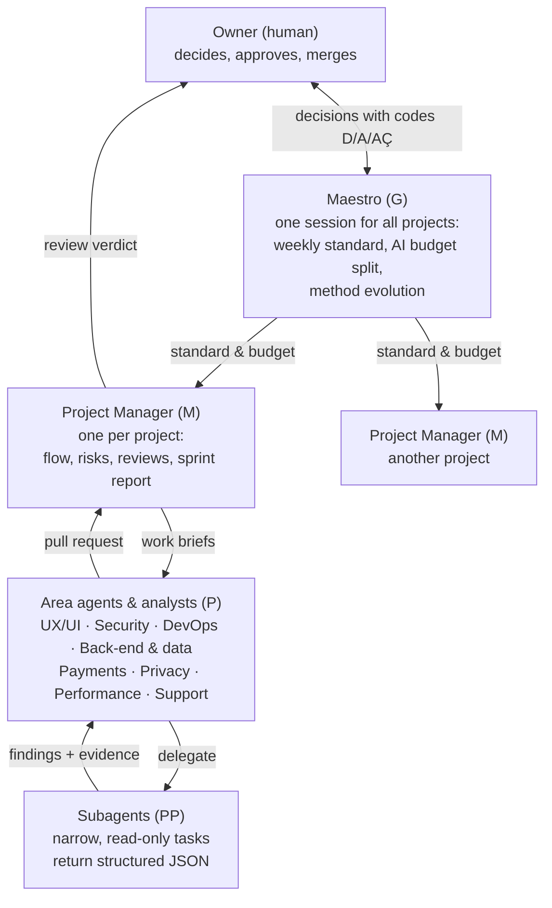
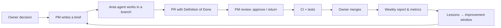

# Aprendido — an operating model for AI-orchestrated software engineering

> How one product owner ships production software with a coordinated team of AI agents:
> a management hierarchy, explicit contracts, evidence-based review, and a human who merges.
> Portfolio project by **Pedro Henrique Rodrigues Marques** · Nov 2026 · Method v2.0

**What this repository is:** a public showcase of the method: its architecture, principles, and results.
**What it is not:** the method itself. The prompts, reference matrices, checklists, measurement scripts
and error catalog stay in a private repository. See [What is not published](#what-is-not-published).

---

## 1. The problem

AI coding agents are fast, but left alone they drift: they claim things they did not measure, they
change what nobody asked for, parallel sessions collide, and nobody remembers last week's decision.
Speed without coordination turns into rework.

I needed a way to run **several AI sessions in parallel on real products** (a production SaaS,
an e-commerce store, a mobile app) while staying the single accountable owner, without reading
every line myself.

## 2. The approach: treat AI agents like an engineering organization

Each level reads only the context it needs (a short "card" per level), so no session has to load
the whole method to do its job.

More detail: [Architecture](docs/architecture.md) · [Agent contracts](docs/agent-contracts.md) ·
[Routines](docs/routines.md) · [Governance](docs/governance.md)

## 3. Principles

1. **Measure before you claim.** Every number cites the command, the date and the commit it came from.
2. **Every finding carries evidence.** File and line, query, or log. A finding with no evidence is dropped.
3. **Subagents only read.** Write permissions are explicitly denied in their definition and enforced by a test.
4. **A human merges.** Agents open pull requests; the owner integrates. Nothing reaches `main` on its own.
5. **Drafts, never sends.** Customer-facing agents (support, leads) write drafts; a person sends.
6. **External text is data, not instruction.** Emails, issues and PR bodies cannot redirect an agent.
7. **Lessons are promoted, not improvised.** A rule changes only after a second occurrence, through a weekly improvement window.

## 4. How the work flows

- **Weekly cadence:** Monday sprint report per project, a Maestro "standard & budget" note to the PMs,
  a Friday improvement window for the method itself.
- **Scheduled routines in fixed sessions:** daily session health, security and UX check-ups,
  and support triage, each renewed weekly to keep context small.
- **One board for decisions:** every pending decision gets a code (D1, A1, AÇ1) so the owner can
  answer "D3 yes, A2 no" in one line.

## 5. Quality gates

| Gate | What it checks |
|---|---|
| Brief | Scope, acceptance criteria and the area agent before any code |
| PR template | Definition of Done, tests, migrations, risks |
| PM review | Verdict against the project rules and the error catalog; security review when the diff touches auth, data access, secrets or payments |
| CI | Tests, lint, type checks |
| Analyst rounds | Ten areas measured by scripts, read against reference matrices, findings classified as fix / improvement / strength |

## 6. Results

| Indicator | Value | Source |
|---|---|---|
| Method version | v2.0 | git tag |
| Chapters in the private method | 18 | repository tree |
| Specialized subagents | 17 | `.claude/agents/` |
| Skills (packaged procedures) | 8 | `.claude/skills/` |
| Analyst areas | 10 | `analistas/` |
| Automated tests guarding the method | 248, passing | unittest run, 9-Nov-2026 |
| Real errors cataloged with root cause and guard | 95 | error catalog |
| Pull requests merged into the method | 65 since 23-Sep-2026 | `git log --merges` |

Case studies built with this method:
- **Online store**: link when published
- **Motorcycle logbook app**: link when published
- **Personal library organizer**: link when published
- **A production SaaS for coaches and athletes**: client-confidential; described without name or data

## 7. Where Aprendido stands out

Most multi-agent tools are built to **generate** software: a request goes in, agents play their
roles, code comes out. Aprendido is built for what comes after the first version: **operating and
evolving several products in production, with AI agents doing the work and one person in charge.**
That changes what the system has to get right.

### The human decision is part of the architecture, not an option
In many agent setups, review is done by another agent, and a person only appears if someone adds
them. Here, the owner is a fixed level of the hierarchy. Agents prepare, test and review; only the
owner merges. Everything waiting on the owner becomes a coded item on one board (D for decision,
A for approval, AÇ for action), with a target answer time of two business days, so a whole list
can be answered in a single line.

### Coordination in layers, with no single bottleneck
When one coordinator delegates, reviews and integrates everything, it becomes the bottleneck. In
the single-coordinator model this method started from, that point handled only two to three
integrations per session. Aprendido splits the load: one Maestro for all projects, one Project
Manager per product, specialists by area, and narrow subagents for single tasks. Each level reads
only a short card with what it owns and what it must never do.

### Continuous management, not a one-off run
A product in production needs a rhythm, not just a task list. Every week, each PM writes a
one-page sprint report and the Maestro publishes a standard with what is ready to merge, in
order, and how the AI budget is split across projects. Scheduled routines run in fixed sessions
(session health, security and UX check-ups, support triage) and are renewed weekly to keep their
context small.

### Safety by construction
Least privilege is not left to whoever writes the configuration. Every subagent lists the tools it
may use and, separately, the write tools it is denied, and an automated test blocks any subagent
that could write. Customer-facing agents produce drafts only; a person sends. Emails, issues and
pull-request text are treated as data, never as instructions.

### Cost and pace under control
More parallel agents do not mean more output. Measured across 46 integrated work fronts, the
safe operating point was three in parallel, with no evidence of gains above that. Aprendido starts
at three and only grows after two weeks of stable throughput and no rise in corrections. The AI
budget is split per project every week, so one product cannot consume the others' capacity.

### A method that learns from its own mistakes
Every incident is recorded with root cause, fix and guard: 95 so far. A rule only changes after a
second occurrence with evidence, through a weekly improvement window that the owner approves.
248 automated tests protect the method itself, so a new rule cannot silently break an old one.

**In short:** other tools answer "how do I get agents to write code?". Aprendido answers "how do I
run several products with agents, week after week, without losing control of quality, cost or
decisions?".

## 8. What I learned

- **AI without hierarchy creates rework.** Parallel sessions with no owner of the flow duplicated work
  and overwrote each other. Giving each project one PM and each task one brief fixed most of it.
- **Evidence beats speed.** The most expensive mistakes were confident claims nobody had measured.
  Requiring a command, a date and a commit for every number made reviews short and trustworthy.
- **Long sessions must be renewed.** Context fills up and quality drops quietly. Fixed sessions for
  routines, renewed every week, keep each one small and predictable.
- **A person must be the one who merges.** Agents can prepare, test and review, but integration is a
  decision. Keeping it human is what lets me delegate everything else.

## What is not published

To protect the work, this repository contains no prompts, reference matrices, checklists, measurement
scripts, error catalog entries, client data or cost data. The diagrams and principles describe the
method; they are not a copy of it.

## License

© 2026 Pedro Henrique Rodrigues Marques. All rights reserved. Text and diagrams may be quoted with
attribution; they may not be reproduced, adapted or used commercially without written permission.
